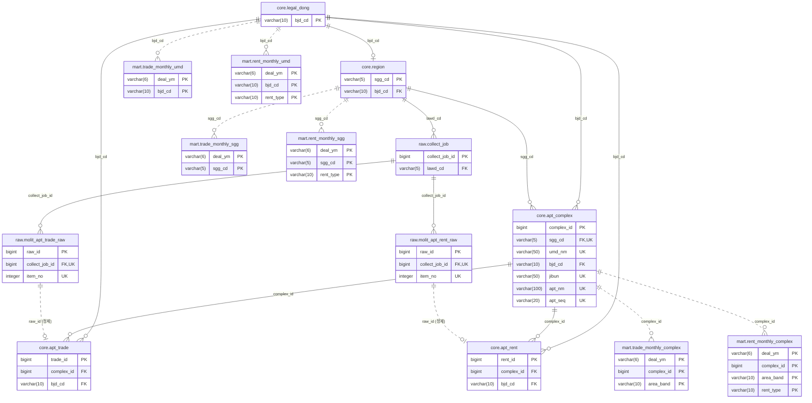

# ziplog ERD

> 이 문서와 다이어그램은 **실제 DB 메타데이터(Flyway V1~V13 적용 결과)에서 자동 생성**했다. 컬럼 설명은 각 마이그레이션의 `COMMENT` 와 같다.
> 설계 배경은 [SDD-001](../sdd/001-db-modeling.md) 참고.

## 범례
- **실선** (`──`): 실제 FK 제약
- **점선** (`┄┄`): 논리 참조 (FK 미설정). raw → core 는 출처 추적용 `raw_id`, core → mart 는 집계 grain 키
- `PK` 기본키 / `FK` 외래키 / `UK` 유니크
- Spring Batch 메타 테이블(`public.batch_*` 6개)과 `flyway_schema_history` 는 제외

## 테이블 목록

| 계층 | 테이블 | 컬럼 수 | 설명 |
|---|---|---|---|
| 정제 | `core.legal_dong` | 13 | 법정동 마스터 (전국, 시도/시군구/읍면동/리). 출처: 국토교통부_전국 법정동 CSV |
| 정제 | `core.region` | 4 | 실거래 수집 대상 시군구 설정 |
| 원천 | `raw.collect_job` | 15 | 수집 단위 로그. 단위 = (API 종류, 시군구, 계약년월), 1 job = 1 스냅샷 |
| 원천 | `raw.molit_apt_trade_raw` | 24 | 국토교통부(MOLIT) 아파트 매매 실거래가 원본 (RTMSDataSvcAptTrade). API 필드 1:1, 받은 값 그대로 |
| 원천 | `raw.molit_apt_rent_raw` | 29 | 국토교통부(MOLIT) 아파트 전월세 실거래가 원본 (RTMSDataSvcAptRent). API 필드 1:1, 받은 값 그대로 |
| 정제 | `core.apt_complex` | 13 | 아파트 단지 마스터. 자연키 (시군구, 법정동명, 지번, 단지명) |
| 정제 | `core.apt_trade` | 24 | 아파트 매매 정제. (시군구, 계약년월) 단위로 delete -> insert 교체 |
| 정제 | `core.apt_rent` | 23 | 아파트 전월세 정제. (시군구, 계약년월) 단위로 delete -> insert 교체 |
| 집계 | `mart.trade_monthly_sgg` | 10 | 아파트 매매 월별 집계 - 시군구 단위 (해제 거래 제외) |
| 집계 | `mart.trade_monthly_umd` | 11 | 아파트 매매 월별 집계 - 법정동 단위 (해제 거래 및 법정동코드 미매칭 거래 제외) |
| 집계 | `mart.trade_monthly_complex` | 12 | 아파트 매매 월별 집계 - 단지 x 전용면적대 단위 (해제 거래 제외) |
| 집계 | `mart.rent_monthly_sgg` | 14 | 아파트 전월세 월별 집계 - 시군구 x 임대유형 |
| 집계 | `mart.rent_monthly_umd` | 15 | 아파트 전월세 월별 집계 - 법정동 (법정동코드 미매칭 거래 제외) x 임대유형 |
| 집계 | `mart.rent_monthly_complex` | 16 | 아파트 전월세 월별 집계 - 단지 x 전용면적대 x 임대유형 |

## 1. 개요 (키 컬럼만)

## 2. 전체 (모든 컬럼 + 설명)

```mermaid
erDiagram
    core_legal_dong ||--o| core_region : "bjd_cd"
    core_legal_dong ||--o{ core_apt_complex : "bjd_cd"
    core_legal_dong ||--o{ core_apt_trade : "bjd_cd"
    core_legal_dong ||--o{ core_apt_rent : "bjd_cd"
    core_region ||--o{ raw_collect_job : "lawd_cd"
    core_region ||--o{ core_apt_complex : "sgg_cd"
    raw_collect_job ||--o{ raw_molit_apt_trade_raw : "collect_job_id"
    raw_collect_job ||--o{ raw_molit_apt_rent_raw : "collect_job_id"
    core_apt_complex ||--o{ core_apt_trade : "complex_id"
    core_apt_complex ||--o{ core_apt_rent : "complex_id"
    raw_molit_apt_trade_raw ||..o| core_apt_trade : "raw_id (정제)"
    raw_molit_apt_rent_raw ||..o| core_apt_rent : "raw_id (정제)"
    core_region ||..o{ mart_trade_monthly_sgg : "sgg_cd"
    core_legal_dong ||..o{ mart_trade_monthly_umd : "bjd_cd"
    core_apt_complex ||..o{ mart_trade_monthly_complex : "complex_id"
    core_region ||..o{ mart_rent_monthly_sgg : "sgg_cd"
    core_legal_dong ||..o{ mart_rent_monthly_umd : "bjd_cd"
    core_apt_complex ||..o{ mart_rent_monthly_complex : "complex_id"

    core_legal_dong["core.legal_dong"] {
        varchar(10) bjd_cd PK "법정동코드 10자리 (시도2 + 시군구3 + 읍면동3 + 리2)"
        varchar(2) sido_cd "시도코드 2자리 (bjd_cd 앞 2자리, 자동 계산)"
        varchar(5) sgg_cd "시군구코드 5자리 (bjd_cd 앞 5자리, 자동 계산) = 실거래 API LAWD_CD"
        varchar(4) level "단계: SIDO/SGG/UMD/RI (이름이 채워진 단계로 자동 계산)"
        varchar(20) sido_nm "NOT NULL. 시도명"
        varchar(20) sgg_nm "시군구명"
        varchar(20) umd_nm "읍면동명"
        varchar(20) ri_nm "리명"
        integer seq "CSV 순번 (일부 행 공란)"
        date created_date "NOT NULL. 법정동 생성일자"
        boolean is_active "NOT NULL. 현존 여부. 최신 원본 파일에서 사라진 코드는 삭제하지 않고 FALSE"
        date source_date "NOT NULL. 이 행을 마지막으로 반영한 원본 파일 기준일"
        timestamptz updated_at "NOT NULL. 수정 시각"
    }
    core_region["core.region"] {
        varchar(5) sgg_cd PK "시군구코드 5자리 = 실거래 API LAWD_CD"
        varchar(10) bjd_cd FK "법정동 마스터의 시군구 행 코드 (sgg_cd || 00000, 자동 계산)"
        boolean collect_enabled "NOT NULL. 수집 대상 여부"
        timestamptz created_at "NOT NULL. 등록 시각"
    }
    raw_collect_job["raw.collect_job"] {
        bigint collect_job_id PK "수집 job ID"
        varchar(20) api_type "NOT NULL. API 종류 (APT_TRADE: 아파트 매매, APT_RENT: 아파트 전월세)"
        varchar(5) lawd_cd FK "NOT NULL. 요청 시군구코드 (API LAWD_CD)"
        varchar(6) deal_ymd "NOT NULL. 요청 계약년월 YYYYMM (API DEAL_YMD)"
        varchar(20) status "NOT NULL. 수집 상태 (RUNNING/SUCCESS/FAILED)"
        integer total_count "API 응답 전체 건수 (totalCount)"
        integer page_count "호출한 페이지 수"
        integer loaded_count "실제 적재 건수 (total_count 와 같아야 SUCCESS)"
        varchar(10) result_code "API 결과 코드 (resultCode)"
        varchar(200) result_msg "API 결과 메시지 (resultMsg)"
        text error_message "실패 시 오류 내용"
        bigint batch_job_execution_id "Spring Batch Job 실행 ID (느슨한 참조)"
        timestamptz started_at "NOT NULL. 수집 시작 시각"
        timestamptz finished_at "수집 종료 시각"
        timestamptz core_applied_at "core 반영 시각 (NULL 이면 미반영)"
    }
    raw_molit_apt_trade_raw["raw.molit_apt_trade_raw"] {
        bigint raw_id PK "원본 행 ID"
        bigint collect_job_id FK,UK "NOT NULL. 수집 job ID"
        integer item_no UK "NOT NULL. 수집 job 내 순번 = (pageNo-1) * numOfRows + 페이지 내 순번"
        timestamptz collected_at "NOT NULL. 수집 시각"
        varchar sgg_cd "[sggCd] 시군구코드"
        varchar umd_nm "[umdNm] 법정동명"
        varchar apt_nm "[aptNm] 단지명"
        varchar jibun "[jibun] 지번"
        varchar apt_dong "[aptDong] 동 (등기 완료 건만 공개)"
        varchar build_year "[buildYear] 건축년도"
        varchar deal_year "[dealYear] 계약년도"
        varchar deal_month "[dealMonth] 계약월"
        varchar deal_day "[dealDay] 계약일"
        varchar deal_amount "[dealAmount] 거래금액 (만원, 천 단위 콤마 포함)"
        varchar exclu_use_ar "[excluUseAr] 전용면적 (㎡)"
        varchar floor "[floor] 층"
        varchar dealing_gbn "[dealingGbn] 거래유형 (중개거래/직거래)"
        varchar estate_agent_sgg_nm "[estateAgentSggNm] 중개사소재지"
        varchar rgst_date "[rgstDate] 등기일자 (yy.MM.dd)"
        varchar cdeal_type "[cdealType] 해제여부 (O: 해제)"
        varchar cdeal_day "[cdealDay] 해제사유발생일 (yy.MM.dd)"
        varchar sler_gbn "[slerGbn] 매도자 구분 (개인/법인/기타 등)"
        varchar buyer_gbn "[buyerGbn] 매수자 구분 (개인/법인/기타 등)"
        varchar land_leasehold_gbn "[landLeaseholdGbn] 토지임대부 아파트 여부 (Y/N)"
    }
    raw_molit_apt_rent_raw["raw.molit_apt_rent_raw"] {
        bigint raw_id PK "원본 행 ID"
        bigint collect_job_id FK,UK "NOT NULL. 수집 job ID"
        integer item_no UK "NOT NULL. 수집 job 내 순번 = (pageNo-1) * numOfRows + 페이지 내 순번"
        timestamptz collected_at "NOT NULL. 수집 시각"
        varchar sgg_cd "[sggCd] 시군구코드"
        varchar umd_nm "[umdNm] 법정동명"
        varchar apt_nm "[aptNm] 단지명"
        varchar jibun "[jibun] 지번"
        varchar apt_seq "[aptSeq] 단지 일련번호"
        varchar build_year "[buildYear] 건축년도"
        varchar deal_year "[dealYear] 계약년도"
        varchar deal_month "[dealMonth] 계약월"
        varchar deal_day "[dealDay] 계약일"
        varchar deposit "[deposit] 보증금 (만원, 천 단위 콤마 포함)"
        varchar monthly_rent "[monthlyRent] 월세 (만원, 0 이면 전세)"
        varchar exclu_use_ar "[excluUseAr] 전용면적 (㎡)"
        varchar floor "[floor] 층"
        varchar contract_term "[contractTerm] 계약기간 (yy.MM~yy.MM, 시작 생략 가능)"
        varchar contract_type "[contractType] 계약구분 (신규/갱신)"
        varchar use_rr_right "[useRRRight] 갱신요구권 사용 (사용)"
        varchar pre_deposit "[preDeposit] 종전계약 보증금 (만원)"
        varchar pre_monthly_rent "[preMonthlyRent] 종전계약 월세 (만원)"
        varchar road_nm "[roadnm] 도로명주소"
        varchar road_nm_sgg_cd "[roadnmsggcd] 도로명 시군구코드"
        varchar road_nm_cd "[roadnmcd] 도로명코드"
        varchar road_nm_seq "[roadnmseq] 도로명 일련번호"
        varchar road_nm_bcd "[roadnmbcd] 도로명 지상/지하 코드"
        varchar road_nm_bonbun "[roadnmbonbun] 도로명 건물 본번"
        varchar road_nm_bubun "[roadnmbubun] 도로명 건물 부번"
    }
    core_apt_complex["core.apt_complex"] {
        bigint complex_id PK "단지 ID"
        varchar(5) sgg_cd FK,UK "NOT NULL. 시군구코드"
        varchar(50) umd_nm UK "NOT NULL. 법정동명"
        varchar(10) bjd_cd FK "법정동코드 10자리 (시군구+법정동명으로 매칭, 실패 시 NULL)"
        varchar(50) jibun UK "NOT NULL. 지번 (없으면 빈 문자열)"
        varchar(100) apt_nm UK "NOT NULL. 단지명"
        varchar(20) apt_seq UK "단지 일련번호 (전월세 API 에만 존재, 전월세 적재 시 채움)"
        smallint build_year "건축년도"
        varchar(100) road_nm "도로명주소 (전월세 API 에서 채움)"
        varchar(6) first_seen_ym "NOT NULL. 최초 거래 관측 년월 YYYYMM"
        varchar(6) last_seen_ym "NOT NULL. 최근 거래 관측 년월 YYYYMM"
        timestamptz created_at "NOT NULL. 등록 시각"
        timestamptz updated_at "NOT NULL. 수정 시각"
    }
    core_apt_trade["core.apt_trade"] {
        bigint trade_id PK "매매 거래 ID"
        bigint complex_id FK "NOT NULL. 단지 ID"
        varchar(5) sgg_cd "NOT NULL. 시군구코드"
        varchar(50) umd_nm "NOT NULL. 법정동명"
        varchar(10) bjd_cd FK "법정동코드 10자리 (시군구+법정동명으로 매칭, 실패 시 NULL)"
        varchar(6) deal_ym "NOT NULL. 계약년월 YYYYMM (수집 단위)"
        date deal_date "NOT NULL. 계약일자"
        bigint deal_amount "NOT NULL. 거래금액 (만원)"
        numeric exclu_use_ar "NOT NULL. 전용면적 (㎡)"
        varchar(10) area_band "NOT NULL. 전용면적대 (LE40: 40이하, LE60, LE85, LE102, LE135, GT135: 135초과)"
        smallint floor "층"
        varchar(20) apt_dong "동"
        smallint build_year "건축년도"
        varchar(10) dealing_gbn "거래유형 (중개거래/직거래)"
        varchar(10) sler_gbn "매도자 구분"
        varchar(10) buyer_gbn "매수자 구분"
        varchar(200) estate_agent_sgg_nm "중개사소재지"
        date rgst_date "등기일자"
        boolean is_canceled "NOT NULL. 해제 여부 (원본 cdealType = O)"
        date cancel_date "해제사유발생일"
        boolean is_land_leasehold "NOT NULL. 토지임대부 아파트 여부"
        bigint collect_job_id "NOT NULL. 출처 수집 job ID"
        bigint raw_id "NOT NULL. 출처 원본 행 ID (raw 보존 정책으로 삭제될 수 있어 FK 미설정)"
        timestamptz loaded_at "NOT NULL. 적재 시각"
    }
    core_apt_rent["core.apt_rent"] {
        bigint rent_id PK "전월세 거래 ID"
        bigint complex_id FK "NOT NULL. 단지 ID"
        varchar(5) sgg_cd "NOT NULL. 시군구코드"
        varchar(50) umd_nm "NOT NULL. 법정동명"
        varchar(10) bjd_cd FK "법정동코드 10자리 (시군구+법정동명으로 매칭, 실패 시 NULL)"
        varchar(6) deal_ym "NOT NULL. 계약년월 YYYYMM (수집 단위)"
        date deal_date "NOT NULL. 계약일자"
        varchar(10) rent_type "NOT NULL. 임대 유형 (JEONSE: 전세 = 월세 0, WOLSE: 월세)"
        bigint deposit "NOT NULL. 보증금 (만원)"
        bigint monthly_rent "NOT NULL. 월세 (만원, 전세는 0)"
        numeric exclu_use_ar "NOT NULL. 전용면적 (㎡)"
        varchar(10) area_band "NOT NULL. 전용면적대 (LE40: 40이하, LE60, LE85, LE102, LE135, GT135: 135초과)"
        smallint floor "층"
        smallint build_year "건축년도"
        varchar(10) contract_type "계약구분 (신규/갱신, 미제공 시 NULL)"
        varchar(6) contract_start_ym "계약 시작 년월 YYYYMM (원본 contractTerm 앞부분)"
        varchar(6) contract_end_ym "계약 종료 년월 YYYYMM (원본 contractTerm 뒷부분)"
        boolean is_rr_right_used "갱신요구권 사용 여부 (사용=TRUE, 계약구분 있고 미사용=FALSE, 정보 없음=NULL)"
        bigint pre_deposit "종전계약 보증금 (만원)"
        bigint pre_monthly_rent "종전계약 월세 (만원)"
        bigint collect_job_id "NOT NULL. 출처 수집 job ID"
        bigint raw_id "NOT NULL. 출처 원본 행 ID (raw 보존 정책으로 삭제될 수 있어 FK 미설정)"
        timestamptz loaded_at "NOT NULL. 적재 시각"
    }
    mart_trade_monthly_sgg["mart.trade_monthly_sgg"] {
        varchar(6) deal_ym PK "계약년월 YYYYMM"
        varchar(5) sgg_cd PK "시군구코드"
        integer trade_count "NOT NULL. 거래 건수 (해제 거래 제외)"
        bigint avg_amount "평균 거래금액 (만원)"
        bigint median_amount "중위 거래금액 (만원)"
        bigint min_amount "최저 거래금액 (만원)"
        bigint max_amount "최고 거래금액 (만원)"
        bigint avg_price_per_pyeong "평균 평당가 (만원/3.3㎡, 전용면적 기준)"
        bigint median_price_per_pyeong "중위 평당가 (만원/3.3㎡, 전용면적 기준)"
        timestamptz refreshed_at "NOT NULL. 집계 갱신 시각"
    }
    mart_trade_monthly_umd["mart.trade_monthly_umd"] {
        varchar(6) deal_ym PK "계약년월 YYYYMM"
        varchar(10) bjd_cd PK "법정동코드 10자리"
        varchar(5) sgg_cd "NOT NULL. 시군구코드 (단위 재계산용)"
        integer trade_count "NOT NULL. 거래 건수 (해제 거래 제외)"
        bigint avg_amount "평균 거래금액 (만원)"
        bigint median_amount "중위 거래금액 (만원)"
        bigint min_amount "최저 거래금액 (만원)"
        bigint max_amount "최고 거래금액 (만원)"
        bigint avg_price_per_pyeong "평균 평당가 (만원/3.3㎡, 전용면적 기준)"
        bigint median_price_per_pyeong "중위 평당가 (만원/3.3㎡, 전용면적 기준)"
        timestamptz refreshed_at "NOT NULL. 집계 갱신 시각"
    }
    mart_trade_monthly_complex["mart.trade_monthly_complex"] {
        varchar(6) deal_ym PK "계약년월 YYYYMM"
        bigint complex_id PK "단지 ID"
        varchar(10) area_band PK "전용면적대"
        varchar(5) sgg_cd "NOT NULL. 시군구코드 (단위 재계산용)"
        integer trade_count "NOT NULL. 거래 건수 (해제 거래 제외)"
        bigint avg_amount "평균 거래금액 (만원)"
        bigint median_amount "중위 거래금액 (만원)"
        bigint min_amount "최저 거래금액 (만원)"
        bigint max_amount "최고 거래금액 (만원)"
        bigint avg_price_per_pyeong "평균 평당가 (만원/3.3㎡, 전용면적 기준)"
        bigint median_price_per_pyeong "중위 평당가 (만원/3.3㎡, 전용면적 기준)"
        timestamptz refreshed_at "NOT NULL. 집계 갱신 시각"
    }
    mart_rent_monthly_sgg["mart.rent_monthly_sgg"] {
        varchar(6) deal_ym PK "계약년월 YYYYMM"
        varchar(5) sgg_cd PK "시군구코드"
        varchar(10) rent_type PK "임대 유형 (JEONSE/WOLSE)"
        integer rent_count "NOT NULL. 거래 건수"
        bigint avg_deposit "평균 보증금 (만원)"
        bigint median_deposit "중위 보증금 (만원)"
        bigint min_deposit "최저 보증금 (만원)"
        bigint max_deposit "최고 보증금 (만원)"
        bigint median_deposit_per_pyeong "중위 평당 보증금 (만원/3.3㎡, 전용면적 기준)"
        bigint avg_monthly_rent "평균 월세 (만원, 전세는 0)"
        bigint median_monthly_rent "중위 월세 (만원, 전세는 0)"
        integer renewal_count "NOT NULL. 갱신 계약 건수"
        integer rr_right_used_count "NOT NULL. 갱신요구권 사용 건수"
        timestamptz refreshed_at "NOT NULL. 집계 갱신 시각"
    }
    mart_rent_monthly_umd["mart.rent_monthly_umd"] {
        varchar(6) deal_ym PK "계약년월 YYYYMM"
        varchar(10) bjd_cd PK "법정동코드 10자리"
        varchar(10) rent_type PK "임대 유형 (JEONSE/WOLSE)"
        varchar(5) sgg_cd "NOT NULL. 시군구코드 (단위 재계산용)"
        integer rent_count "NOT NULL. 거래 건수"
        bigint avg_deposit "평균 보증금 (만원)"
        bigint median_deposit "중위 보증금 (만원)"
        bigint min_deposit "최저 보증금 (만원)"
        bigint max_deposit "최고 보증금 (만원)"
        bigint median_deposit_per_pyeong "중위 평당 보증금 (만원/3.3㎡, 전용면적 기준)"
        bigint avg_monthly_rent "평균 월세 (만원, 전세는 0)"
        bigint median_monthly_rent "중위 월세 (만원, 전세는 0)"
        integer renewal_count "NOT NULL. 갱신 계약 건수"
        integer rr_right_used_count "NOT NULL. 갱신요구권 사용 건수"
        timestamptz refreshed_at "NOT NULL. 집계 갱신 시각"
    }
    mart_rent_monthly_complex["mart.rent_monthly_complex"] {
        varchar(6) deal_ym PK "계약년월 YYYYMM"
        bigint complex_id PK "단지 ID"
        varchar(10) area_band PK "전용면적대"
        varchar(10) rent_type PK "임대 유형 (JEONSE/WOLSE)"
        varchar(5) sgg_cd "NOT NULL. 시군구코드 (단위 재계산용)"
        integer rent_count "NOT NULL. 거래 건수"
        bigint avg_deposit "평균 보증금 (만원)"
        bigint median_deposit "중위 보증금 (만원)"
        bigint min_deposit "최저 보증금 (만원)"
        bigint max_deposit "최고 보증금 (만원)"
        bigint median_deposit_per_pyeong "중위 평당 보증금 (만원/3.3㎡, 전용면적 기준)"
        bigint avg_monthly_rent "평균 월세 (만원, 전세는 0)"
        bigint median_monthly_rent "중위 월세 (만원, 전세는 0)"
        integer renewal_count "NOT NULL. 갱신 계약 건수"
        integer rr_right_used_count "NOT NULL. 갱신요구권 사용 건수"
        timestamptz refreshed_at "NOT NULL. 집계 갱신 시각"
    }
```

